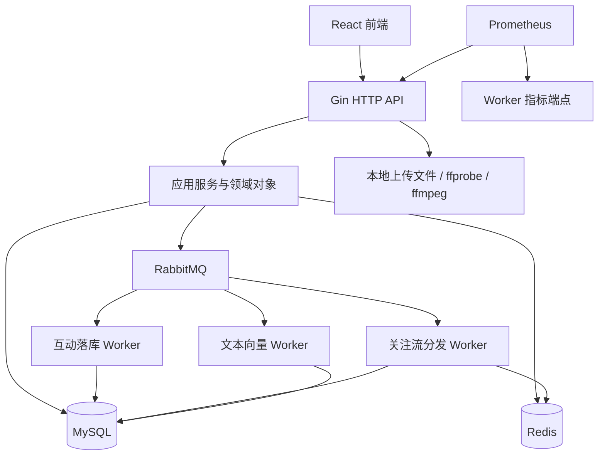

# GCFeed 校招后端项目独立评估

评估日期：2026-10-30。

本报告根据当前工作区源码、测试代码和部署配置重新评估，不沿用已有学习路线、项目分析或简历亮点文档。不讨论安全问题。这里的 P0/P1/P2 表示本项目备战面试的处理优先级，不是线上事故评级。

## 1. 结论

**可以作为校招后端主项目，而且已有足够的技术内容。现在最需要的是修通业务闭环、解释设计边界、补齐验证证据，而不是继续增加模块。**

建议定位为：

> 基于 Go 的短视频 Feed 与互动平台，围绕多场景信息流读取、关注流推拉分发、异步互动和缓存一致性展开设计与验证。

当前实现适合支撑 Go Web、SQL、事务、Redis、消息队列、接口设计和工程测试的讨论。是否能在面试中形成优势，取决于你能否独立解释和复现关键链路，不能只凭技术栈数量判断，也不能保证录用结果。

| 评估维度 | 当前判断 | 判断依据 |
| --- | --- | --- |
| 业务覆盖 | 足够作为主项目 | 账号、视频、互动、关系、Feed、消息、曝光、推荐、播放数据均有实现 |
| 架构可解释性 | 较好 | interfaces/application/domain/infra 分层，HTTP 与 worker 分进程 |
| 技术深度素材 | 充足 | 复合游标、分层缓存、singleflight、分钟热榜、推拉结合、异步落库 |
| 当前可演示性 | 尚未通过 | 后端当前存在编译错误；前端本地缺少 Vite，构建未完成 |
| 一致性与故障恢复 | 需要重点补齐 | 事件发布、状态回源、事件乱序、索引完整性存在缺口 |
| 性能证明 | 尚不足 | 有指标与仪表盘配置，本次未获得可复现压测结果 |
| 面试表述边界 | 必须明确 | 模块化单体加 worker；本地文本特征推荐原型；尚无大规模生产验证 |

## 2. 本次验证的实际结果

分析范围包括后端启动装配、各业务服务与核心仓储、Redis/MQ、数据库模型与迁移、测试、前端业务调用、Docker Compose、Kubernetes 配置和监控配置。没有部署完整环境，也没有执行真实中间件集成测试或压测。

| 检查 | 结果 | 能证明什么 |
| --- | --- | --- |
| `apps/api` 中运行 `go test ./...` | 失败 | `internal/interfaces/http/upload/handler.go:380` 有独立字符 `a`，导致 API 入口、router、upload 和 test 包构建失败 |
| 同次运行中的 embedding 领域测试 | 通过 | 本地向量相关测试通过 |
| 同次运行中的 infra/cache 测试 | 通过 | 现有缓存辅助逻辑测试通过；该文件使用 fake Redis |
| `apps/web` 中运行 `npm.cmd run build` | 未完成构建 | 本地无法找到 `vite`；这是依赖环境缺失，不能据此认定前端源码错误 |
| `docker compose -f apps/docker-compose.yml config --quiet` | 通过 | Compose 配置可解析，不代表容器或服务已正常运行 |
| 静态统计 `func Test` | 58 个入口 | 是测试函数数量，不是本次通过数量，也不是覆盖率 |

已有 API 测试大量使用 memory repository、fake cache、stub publisher/processor。它们可以验证 Handler/Service 的正常流程与部分边界，不能验证真实 SQL 的行锁与执行计划、Redis WATCH 冲突或 RabbitMQ 故障恢复。

工作区原本已有未提交修改。本次只新增评估和学习方案文档，没有修正业务代码，也没有覆盖原有文档。

## 3. 项目实际架构

**这是模块化单体 API 加后台 worker 的架构。** 多个业务模块共享代码库和数据库，不能仅因为存在两个进程就称为完整微服务系统。

分层的价值是可替换依赖、隔离 HTTP 和业务逻辑、便于测试。领域层主要承载实体、校验、状态和仓储接口，应用层承担较多编排；面试时应按实际职责解释，不必强称为复杂 DDD 实践。

### 模块盘点

| 模块 | 已有实现 | 面试价值与边界 |
| --- | --- | --- |
| 账号 | 注册、登录、公开资料、资料更新、作品与关系计数 | 适合讲请求链路、部分更新、唯一约束，不建议作为主要亮点 |
| 视频 | 发布、作者作品、软删除、发布幂等、video/video_stat 同事务保存 | 适合讲事务边界、重复请求和发布事件 |
| 上传 | 本地保存、ffprobe 元信息、ffmpeg faststart、静态文件服务 | 是媒体处理原型；faststart 使用 `-c copy`，不能表述为多码率转码平台 |
| 互动 | 点赞、收藏、评论、计数；可启用 Redis + MQ 异步路径 | 最适合研究并发、幂等、乱序与计数一致性 |
| 关系 | 关注/取关、关系计数、分页、新关注回填 | 与关注流结合，可讲事务与派生索引维护 |
| 时间线 Feed | 时间+ID 游标、轻量页/卡片/计数缓存、批量加载、singleflight | 最适合作为第一条深入掌握的主线 |
| 关注 Feed | 小作者 inbox、大作者 outbox、合并读取、数据库回源 | 有辨识度，但索引完整性和取关处理待完善 |
| 热门 Feed | 60 个分钟桶合并、窗口缓存、窗口游标 | 可讲滚动窗口、快照生命周期和成本 |
| 推荐 | hash n-gram 文本特征、余弦相似度、热度/新鲜度、作者打散、曝光过滤 | 是可解释的规则与内容特征推荐原型，没有训练模型或 ANN 召回 |
| 曝光/行为 | 行为流水、曝光聚合、事件发布 | 接口存在，但前端正反馈上报和 MQ 消费尚未闭环 |
| 消息 | 点赞/评论/关注通知、事件去重、未读统计、已读更新 | 站内消息，不是实时聊天系统；部分通知仍在业务请求内同步写入 |
| 播放 | 网络配置、时间线预加载、QoS 流水、前端质量统计 | 可以展示业务观测，尚未证明播放性能提升 |
| 运维 | Compose、Kubernetes 清单、Prometheus、Grafana | 工程配套，配置存在与部署验证要分开表述 |

核心事实入口：`apps/api/internal/interfaces/http/router/router.go`、`apps/api/cmd/worker/main.go`、各 `application/*/service.go`、`apps/web/src/App.jsx`。

## 4. 最值得在面试中深入讲的三条主线

### 4.1 Feed 为什么拆成页、卡片、计数

代码：`apps/api/internal/application/feed/service.go:562`，`apps/api/internal/infra/cache/feed_cache.go`，`apps/api/internal/infra/persistence/feed/gorm.go`。

当前页缓存只保存排序与组装所需信息；卡片包含标题、作者和资源地址；计数单独缓存。卡片 TTL 为 15 分钟，计数 TTL 为 15 秒，时间线首页基础 TTL 为 5 秒，后续页基础 TTL 为 45 秒，页缓存另有抖动计算。

值得解释的是：不同字段变更频率不同，整页缓存会让计数更新牵动整页数据；批量读卡片和统计避免逐项查询；复合游标让相同发布时间下仍有确定顺序。

必须补充边界：singleflight 只合并当前进程内相同 key 的页回源；卡片和计数回源没有同等合并机制；登录用户互动状态仍查数据库；整条请求尚未成为“纯缓存请求”。

### 4.2 关注流为什么推拉结合

代码：`apps/api/internal/application/video/fanout_worker.go`，`apps/api/internal/application/feed/service.go:468`，`apps/api/internal/infra/cache/feed_cache.go:282`。

当前以 10000 粉丝为阈值：小作者发布时分批写粉丝 inbox，大作者写自己的 outbox，用户读关注流时合并 inbox 与所关注大作者 outbox。单批粉丝数量默认 500，inbox/outbox 分别截断为 1000/500 条。

可讨论的取舍是发布写放大、读时合并成本、活跃粉丝比例、发文频率和索引存储量。10000 是代码配置常量，不能声称已通过真实业务数据确定最优阈值。

### 4.3 异步互动怎样保证最后正确

代码：`apps/api/internal/application/interaction/service.go:301`，`apps/api/internal/infra/cache/feed_cache.go:437`，`apps/api/internal/application/interaction/worker.go:33`。

当前流程是读数据库初始统计、更新 Redis 状态和分片计数、发事件、worker 调用仓储落库。事件发布返回错误时回退同步落库。

这条链路已经有讨论价值，但暂不能宣传为“可靠最终一致”。需要能回答：状态过期怎样恢复、Redis 成功后进程退出怎么办、同用户操作乱序怎么办、重复旧消息怎么办、数据库已应用的增量怎样避免重复计算。

## 5. 按收益排序的优化清单

以下是源码确认的缺口或具有明确触发路径的风险。除编译失败外，没有将未执行的故障实验描述为已复现结果。

### P0：恢复构建并形成最小可演示基线

证据：`apps/api/internal/interfaces/http/upload/handler.go:380`；本次全量测试已实际报错。

处理：去除误入代码的字符，恢复构建；安装锁文件对应的前端依赖后构建；在独立演示环境完成注册、上传发布、刷 Feed、关注、点赞、评论和消息查看。

验收：全量 Go 测试和前端构建通过；从空环境有可重复启动步骤；有演示数据；不得把 Compose 配置解析成功当作业务验收成功。

### P1-1：修正 Redis 行为状态丢失后的错误增量

证据：`apps/api/internal/infra/cache/feed_cache.go:437`。缺失的 `actionKey` 被视为没有有效行为，只传入初始计数，没有读取数据库中的该用户行为状态。

触发例子：

1. 数据库记录某用户已点赞，统计为 1。
2. 该用户 Redis 行为 key 过期或缓存被清理。
3. 用户取消点赞。代码将缺失状态视为 0，得到 delta=0，应用服务不发布消息，数据库依旧保持已点赞。
4. 若此时用户重复点赞，可能对已有数据库基数再加 1，而数据库状态实际没有变化。

修正方向：缓存缺失时恢复用户行为状态及版本；优先建立数据库状态作为真相源的简单实现。若保留 Redis 优先写，要明确重建和事件持久化协议。

验收：分别删除行为 key、统计 key 和全部相关 key 后测试 PUT/DELETE；接口、Feed 状态和数据库最终一致。

### P1-2：补齐事件持久化、重复处理和乱序控制

证据：

- `apps/api/internal/application/video/service.go:84` 和 `apps/api/internal/application/exposure/service.go` 忽略发布错误。
- `apps/api/internal/infra/mq/rabbitmq.go` 使用持久消息和手动 ACK，但没有看到 publisher confirm、有限重试、死信配置、消费 QoS 和连接恢复流程。
- `apps/api/internal/application/interaction/worker.go:33` 不使用 EventID 或版本裁决，仅把目标状态交给 `SetAction`。

可能后果：视频已保存但关注流或 embedding 不更新；Redis 已变化而事件尚未可靠发布；旧点赞事件在取消点赞之后重放使状态倒退；不可处理消息持续 requeue。

建议先选一种清楚的正确性基线：

- 对发布事件：业务数据与 outbox 记录同一个 MySQL 事务提交；relay 确认发布后标记，允许重复投递，由消费者幂等处理。
- 对互动：校招阶段优先考虑数据库事务提交状态/版本与 outbox，再异步维护缓存；如果坚持 Redis 优先写，需要额外设计可靠事件记录和恢复机制，不能套用 MySQL outbox 就声称解决了 Redis 变更窗口。
- 状态更新按 `(user_id, video_id, action_type)` 的单调版本裁决，事件去重与版本控制分别解决重复和过期写入。
- 失败分为可重试、永久失败，配置有限次数、退避、死信及重放入口。

验收：重复投递、逆序投递、数据库提交后进程退出、消费提交后 ACK 前退出、broker 暂停和恢复都有对应实验与数据库断言。

### P1-3：修正关注流“索引有数据就完整”的假设

证据：`apps/api/internal/infra/cache/feed_cache.go:282`，`apps/api/internal/application/relation/service.go:141`，`apps/api/internal/application/feed/service.go:468`。

当前只要任一 ZSET 非空就认为索引可用。取关没有删除小作者 inbox 内容，读取 inbox 也没有按当前全部关注关系过滤；Redis 返回错误时，关注策略直接报错，未回退数据库。

具体边界：

- 取关后，旧 inbox 内容仍可能返回。
- 某大作者 outbox 缺失，但用户 inbox 非空，整体查询不会因这个缺失回源。
- 翻到截断的 1000/500 条之外，可能提前结束，而数据库仍有历史内容。
- 新关注回填只有最近 100 条；“已有索引”不等于覆盖了所有历史。
- 作者跨越大/小作者阈值，历史 outbox/inbox 没有迁移或覆盖水位约定。
- 关注事务已成功、回填失败时，接口返回错误，用户观察到的成功语义不清晰。

修正方向：读时按有效关系过滤；给索引增加完整性状态与覆盖水位；缺失、越过保留边界或缓存错误时受控回源；关系变更与索引更新采用可重试任务；阈值切换规定过渡行为。

验收：取关、空索引、部分 key 丢失、深翻页、作者跨阈值、Redis 暂停各有回归场景。

### P1-4：补齐推荐反馈闭环，明确画像的实际计算方式

证据：

- `apps/web/src/App.jsx:610` 向行为接口发送的是 `exposed`。
- `apps/api/internal/infra/persistence/recommendation/gorm.go` 画像只读取 `play`、`complete`，并在每次推荐请求时聚合最近 200 条、30 天内的正反馈。
- `apps/api/cmd/worker/main.go:77` 只启动互动、fanout、embedding 三种 worker。
- `ConsumeViewEventRecorded` 有定义，但没有找到启动调用。

因此，仅通过当前前端浏览，不能完整演示“观看兴趣驱动推荐变化”。QoS 写入另一条链路，不会自动成为画像正反馈。观看事件队列启用后还可能不断积累未消费消息。

修正方向：先接通实际播放与完播上报、事件去重和查询画像验证；再决定使用在线聚合加缓存，还是新增画像 worker。两种方案选一种，说明更新延迟和恢复方式；没有消费者时不应留下无用途的常开队列。

验收：两个用户看不同主题的视频后，在固定候选池中得到可解释的不同排序；记录冷启动路径、重复事件影响和画像新鲜度。

### P1-5：把“幂等”和“读到自己的修改”区分开

证据：`apps/api/internal/application/feed/service.go:636` 仍通过 `BatchGetViewerActionStates` 读数据库；异步写先更新 Redis。

worker 积压时，点赞接口可以返回成功、计数已经变化，但刷新 Feed 的 `liked` 仍为 false。这个问题与重复 PUT 不多加计数是不同维度。

修正方向：明确接口一致性约定；读用户状态时优先读取带版本的缓存并对缺失回源，或改用数据库提交后再返回成功的基线。并处理 Redis 统计基数/分片过期不同步导致的计数偏差。

分片细节：base 和当前 shard 会刷新 TTL，其他 shard 可独立过期；历史 delta 消失而 base 未更新时会少计。JSON 缓存若已经包含 delta，再作为 fallback 与残留分片相加也有重复计数风险。需要统一快照代际、重建协议或简化计数模型。

验收：暂停 worker 后点赞并刷新；快进过期时间或删除部分统计 key；消费者恢复后与真实行为行数核对。

### P1-6：处理跨请求变动的推荐分页与热榜快照

证据：`apps/api/internal/application/recommendation/service.go:99`、`:374`，`apps/api/internal/infra/cache/feed_cache.go:374`。

推荐每页重新计算候选与分数，再用上一页分数过滤。跨分钟的新鲜度、互动热度、画像和曝光变化都可能让上一页视频重新落到游标后面，产生重复或漏项。每次只取固定上限候选池，也需要定义池耗尽后的补充策略。

热榜虽然游标固定 `windowEnd`，但窗口结果只缓存 2 分钟；过期后会从可能已变化或过期的分钟桶重建，同一游标不必然对应同一排名。

修正方向：推荐 session 固定候选顺序与版本，游标引用 session/offset；热榜定义快照保留时间和游标过期协议。若采用允许漂移的弱一致性分页，要明确允许程度并测试去重率，不能宣称严格稳定。

验收：跨分钟翻页、翻页过程中点赞/曝光、候选不足、快照过期时，无重复保证或过期重刷行为符合既定协议。

### P2-1：缓存失效、降级与并发回源

证据：`apps/api/internal/application/video/service.go:135` 删除只改数据库；卡片缓存可以保留 15 分钟；时间线页和关注索引可继续引用旧 ID。账号资料更新也不会主动刷新视频卡片内的作者资料。

建议：建立视频状态/作者资料变更后的失效策略，读时过滤无效条目并有限补齐；为删除状态定义可见性时限；统一各 Feed 场景缓存错误时的行为。热门缓存错误当前也直接返回错误，不能泛称“Redis 不可用自动降级”。

进一步实验：检查 singleflight 共享首个请求 context 对其他请求的影响；针对卡片/统计热点回源设计合并；批量查询并行化必须先用耗时拆分证明收益。

### P2-2：数据库锁顺序与 SQL 成本

证据：`apps/api/internal/infra/persistence/relation/gorm.go:41` 先锁发起者、再锁目标用户。A 关注 B 与 B 关注 A 并发时有交叉等待的触发路径。应按一致的用户 ID 顺序加锁，并对可重试事务错误设置有限重试，使用真实 MySQL 验证。

其他值得测量的查询：

| 位置 | 当前特征 | 建议实验 |
| --- | --- | --- |
| `persistence/interaction/gorm.go` | 同视频互动先锁视频行，再改统计行 | 比较普通视频与热点视频的锁等待；异步不会自动消除数据库热点 |
| `persistence/account/gorm.go` | 单用户查询带全表分组派生统计 | 用 EXPLAIN ANALYZE 比较按用户统计、统计表读取与现有 JOIN |
| `persistence/message/model.go:21` | `idx_user_created` 只有 created_at 标签，user_id 未加入该索引；另有 user/read/time 索引 | 对全部消息分页检查实际 SHOW INDEX 和执行计划，再决定补 `(user_id, created_at, id)` |
| `persistence/recommendation/gorm.go` | JOIN 后按计算热度排序 | 测候选规模增加后的扫描和排序成本，再考虑预计算候选 |
| `persistence/feed/gorm.go` | 已有 status/published_at/id 索引 | 验证深分页与 offset 的扫描差异，避免重复添加等价索引 |

不要仅凭 SQL 长度或索引名字断言性能。记录数据规模、执行计划、扫描行数、延迟和锁等待。

### P2-3：关注流 score 与数据库顺序保持一致

证据：`apps/api/internal/infra/cache/feed_cache.go:720` 使用 `Unix秒*1000000 + videoID%1000000`，而业务排序是完整发布时间和完整 ID。

同秒内 ID 跨越一百万边界时取模会倒转顺序；同秒且 ID 相差一百万会得到相同 score，排他 score 游标可能跳过同分成员。该方案也忽略亚秒时间。问题是编码语义不一致，不能简单归咎于当前数值超过浮点精度。

建议：设计能保留真实复合顺序的索引/成员编码，或者读取同分候选后以完整元组裁剪；明确历史数据排序规则。

验收：同秒、不同亚秒、ID 跨取模边界、同 score 的分页全部覆盖。

### P2-4：补足测试和性能证据

新增重点应该是真实组件和故障边界，而不是重复编写已被正常流程覆盖的 Handler 测试。

- MySQL：事务计数、唯一约束、互相关注、热点视频、回滚。
- Redis：WATCH 冲突、过期、重建、部分 key 丢失；当前 `SetActionState` 没有看到对 `redis.TxFailedErr` 的有界重试。
- RabbitMQ：重复、乱序、重启、毒消息、ACK 前后退出、死信重放。
- 系统：worker 暂停时的写后读；缓存故障时数据库压力；发布到关注流可见的延迟。

压测至少分别测匿名/登录 Feed、冷/热缓存、普通/热点视频、正常/故障状态。记录吞吐、P50/P95/P99、错误率、SQL 次数、缓存命中率、队列积压、消费延迟和资源使用。所有“提升百分比”都需配同环境的前后结果。

### P2-5：工程可维护性与生命周期

建议把迁移从每个服务的启动路径中拆出，避免 API 与 worker 同时迁移；集中管理关闭数据库、Redis、MQ；API 增加有界优雅停机；worker 等待在途任务完成后关闭连接；区分进程存活与业务依赖就绪。

现有 `/health` 返回固定成功，不能说明依赖健康。监控已有请求和 worker 指标，可增加队列延迟、重试/死信、版本冲突、对账差异和关注索引回源次数。

前端 `App.jsx` 约 2800 行，可按页面和 API 客户端拆分，但对后端校招的收益低于上述一致性工作。上传处理可后续移到有并发上限的任务队列，并引入处理状态；本地文件存储的扩容边界也应讲清。

## 6. 选哪些做，哪些暂缓

| 优先级 | 建议投入 |
| --- | --- |
| 面试前必须完成 | 构建与演示基线；能画出真实链路；修复/解释关键一致性问题；补真实中间件验证 |
| 首批重点优化 | 状态丢失重建、可靠发布与版本控制、关注索引完整性、Feed 缓存与 SQL 对比实验 |
| 有余力再做 | 推荐反馈闭环、推荐会话快照、上传异步任务、优雅停机与细化监控 |
| 暂缓 | 为展示技术栈而拆微服务、引入多种 MQ、盲目分库分表、上复杂向量数据库、重做前端视觉 |

不要求为了校招把所有 P2 都实现。建议完整完成两项有证据的优化，第三项做到设计、测试和边界解释。修正当前会导致明显错误的行为，优先于追求架构规模。

## 7. 简历和面试如何表述

现在可以基于源码描述：

> 开发基于 Go/Gin 的短视频 Feed 平台，提供时间线、热门、关注和推荐入口；使用轻量页、视频卡片和互动统计分层缓存，结合复合游标和批量查询组织 Feed 读取；通过 RabbitMQ worker 实现关注流分发和视频文本特征生成。

只有完成对应工作和实验后，再增加：

> 针对发布事件丢失和重复消费设计事务 outbox、重试与幂等处理，通过故障注入验证恢复；在指定数据规模与并发条件下，对缓存及索引优化进行前后压测。

性能数字必须填实测值。不要把 hash n-gram 表述为训练的大模型，把 faststart 表述为完整转码系统，把手动 ACK 表述为 exactly-once，把 Redis 分片计数表述为已经解决所有热点瓶颈。

准备一个 5 分钟讲解：30 秒业务与架构、90 秒 Feed、90 秒互动一致性、60 秒一项真实实验、30 秒仍存在的限制。长面试再展开关注流和推荐。

## 8. 面试准备完成的判据

1. 能从一个 HTTP 请求一直讲到 SQL、Redis key 和 MQ 事件。
2. 能手写复合游标条件、关键唯一约束及点赞状态转换。
3. 能解释每个缓存的来源、TTL、失效、缺失回源和故障行为。
4. 能明确区分重复请求、重复消息、事件乱序、读写延迟和数据丢失。
5. 能展示至少一个真实故障复现、修复和回归测试。
6. 能展示一份同环境前后压测，而不是仅展示监控截图。
7. 能坦诚说明模块化单体、推荐原型、部署验证和性能验证的边界。

对应的重新学习方案见同目录 `campus-backend-study-plan-2026-10-30.md`。
