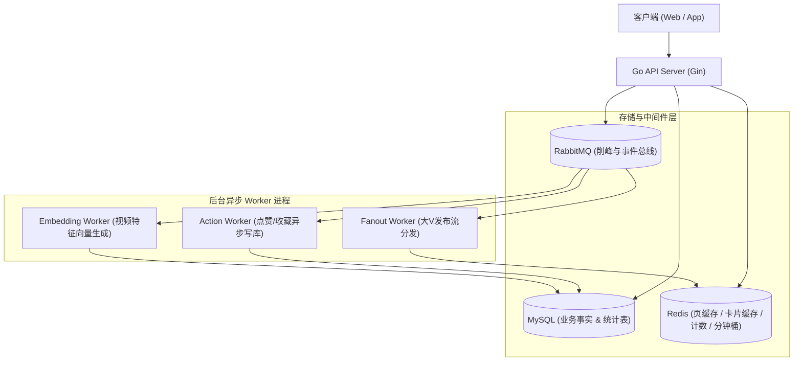
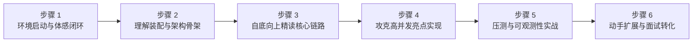

# GCFeed 项目深度分析与系统化学习指南

本文档全面梳理 **GCFeed (面向短视频高并发场景的 Feed 流系统)** 的架构设计、核心技术亮点，并提供循序渐进的系统化学习路线。

---

# 一、 项目深度详细分析

## 1. 系统业务与架构总览

GCFeed 采用典型的**现代 Go 单体分层服务 + 异步 Worker 进程**架构，通过 MySQL 做业务持久化，搭配 Redis 缓存与 RabbitMQ 消息队列进行削峰与解耦：



---

## 2. 后端代码四层架构规范 (DDD / Clean Architecture)

后端代码位于 [`apps/api`](file:///c:/Users/rsty/Desktop/gofeed/GCFeed/apps/api)，严格遵循清晰的依赖倒置四层分层：

| 层次 | 目录位置 | 核心职责 | 依赖规则 |
| :--- | :--- | :--- | :--- |
| **Interfaces (接口层)** | [`internal/interfaces/http`](file:///c:/Users/rsty/Desktop/gofeed/GCFeed/apps/api/internal/interfaces/http) | Gin 路由、参数解析校验、中间件 (JWT/内部鉴权)、DTO 转换、HTTP 状态码映射 | 调用 Application Service |
| **Application (应用层)** | [`internal/application`](file:///c:/Users/rsty/Desktop/gofeed/GCFeed/apps/api/internal/application) | 业务用例编排、游标组装、缓存读取策略、幂等保障、跨模块协作 | 依赖 Domain 抽象接口 |
| **Domain (领域层)** | [`internal/domain`](file:///c:/Users/rsty/Desktop/gofeed/GCFeed/apps/api/internal/domain) | 领域实体 (Entity)、业务不变量约束、领域错误定义、仓储抽象接口 (`Repository`) | **纯净层**，仅依赖 Go 标准库 |
| **Infrastructure (基础设施层)** | [`internal/infra`](file:///c:/Users/rsty/Desktop/gofeed/GCFeed/apps/api/internal/infra) | GORM MySQL 读写模型、Redis 缓存实现、RabbitMQ 生产者/消费者、JWT、Prometheus Metrics | 实现 Domain 与 Application 的接口 |

---

## 3. 四大核心 Feed 流场景机制

在 [`application/feed/service.go`](file:///c:/Users/rsty/Desktop/gofeed/GCFeed/apps/api/internal/application/feed/service.go) 中，通过统一的 `Strategy` 策略接口承载不同场景：

1. **Timeline Feed (时间线流)**：基于 `published_at DESC, id DESC` 排序。采用复合 Base64 游标分页，保证滚动分页时新视频插入不漏数、不重复。
2. **Hot Feed (热门榜单流)**：基于点赞(+3)、收藏(+4)、评论(+5)等互动加权，使用 Redis ZSET **按分钟分桶**存储 (`feed:hot:minute:v1:{yyyyMMddHHmm}`)，查询时利用 `ZUNIONSTORE` 合并最近 60 分钟桶形成 1 小时滑动窗口热榜。
3. **Following Feed (关注流)**：**推拉结合 (Push-Pull Hybrid)**。
   - 普通小作者发布视频：推模式（Fanout 到粉丝的 Redis Inbox）。
   - 大 V / 活跃作者发布：拉模式（写入作者 Outbox，读取时聚合）。
   - 新增关注时支持近期视频回填（Backfill）。
4. **Recommend Feed (推荐流)**：调用推荐模型从候选池召回公开内容，基于用户历史曝光记录去重过滤，综合计算兴趣相似度、热度分与新鲜度分，并执行作者打散（Author Diversification）。

---

## 4. 关键高并发设计亮点

* **ID-Detail 分离架构**：Feed 列表只查询并缓存轻量级视频 ID 序列；详情卡片（标题、封面、作者）与互动计数（赞/评/藏）通过 Redis 批量 `MGET` 聚合，大幅缩减缓存体积并规避 N+1 查询。
* **高并发防雪崩与防击穿**：
  * **Singleflight**：Feed 页缓存未命中时，合并瞬时相同 Key 的数据库并发回源。
  * **TTL 抖动 (Jitter)**：随机抖动过期时间，避免缓存集中失效。
  * **缓存降级**：Redis 偶发抖动或不可用时自动降级回源 MySQL。
* **异步互动落库与最终一致性**：
  * 点赞/收藏请求先写入 Redis 行为状态与实时计数，立即返回客户端。
  * 投递 `ActionChangedEvent` 到 RabbitMQ，后台 Worker 保证幂等批量写入 MySQL 并维护 `video_stat` 计数表。

---

# 二、 深入理解与学习该项目的 6 个步骤



---

### 步骤 1：跑起来，体验核心业务闭环（30 分钟）

**目标**：把项目与周边依赖跑起来，通过自动化测试与接口调用建立全局直观认知。

1. **查看已有文档总览**：
   * 首先阅读 [docs/quickread.md](file:///c:/Users/rsty/Desktop/gofeed/GCFeed/docs/quickread.md)（官方极简导读指南）。
   * 浏览 [docs/architecture.md](file:///c:/Users/rsty/Desktop/gofeed/GCFeed/docs/architecture.md) 系统架构图。
2. **运行单元与集成测试**：
   在终端运行整个后端测试套件：
   ```bash
   go test -v -C "apps/api" ./...
   ```
   *观察 `test/*_api_test.go` 如何使用内存仓储实现全流程无外置依赖的 API 级别测试*。
3. **本地启动 Docker 容器全家桶**（需本地 Docker 环境）：
   ```bash
   cd apps
   docker compose up -d --build
   ```
   体验 Web 前端 (`http://127.0.0.1:5173`)，观察完整的“注册 -> 登录 -> 发布视频 -> 刷新 Feed -> 点赞评论”流程。

---

### 步骤 2：剖析服务启动与依赖装配机制（1~2 小时）

**目标**：理解项目如何不依赖复杂的重量级 DI 框架，使用纯 Go 优雅管理依赖。

1. **阅读服务入口**：
   * 打开 [`apps/api/cmd/feed/main.go`](file:///c:/Users/rsty/Desktop/gofeed/GCFeed/apps/api/cmd/feed/main.go)。
   * 查看配置加载 -> 数据库初始化 -> Gin 引擎创建 -> 路由装配。
2. **重点攻克装配中心**：
   * 精读 [`internal/interfaces/http/router/router.go`](file:///c:/Users/rsty/Desktop/gofeed/GCFeed/apps/api/internal/interfaces/http/router/router.go) 中的 `Register` 函数。
   * **思考并记住依赖流向**：
     $$\text{Config} \longrightarrow \text{DB/Redis/MQ/JWT} \longrightarrow \text{Repository} \longrightarrow \text{Service (Option 注入)} \longrightarrow \text{Handler} \longrightarrow \text{Router}$$
3. **理解 Worker 进程**：
   * 阅读 [`apps/api/cmd/worker/main.go`](file:///c:/Users/rsty/Desktop/gofeed/GCFeed/apps/api/cmd/worker/main.go)。
   * 看它如何独立订阅 RabbitMQ 队列并拉起 `ActionWorker`、`FanoutWorker` 和 `EmbeddingWorker`。

---

### 步骤 3：按业务主线自底向上读源码（1~2 天）

**目标**：从简单业务过渡到复杂业务，掌握标准四层代码的开发规范。

建议按照以下顺序逐条链路追踪：

#### 链路 1：账户模块 (熟悉分层标准模板)
* **路由**：`POST /api/users`、`POST /api/sessions`
* **阅读路径**：
  [`interfaces/http/account/handler.go`](file:///c:/Users/rsty/Desktop/gofeed/GCFeed/apps/api/internal/interfaces/http/account/handler.go) $\to$
  [`application/account/service.go`](file:///c:/Users/rsty/Desktop/gofeed/GCFeed/apps/api/internal/application/account/service.go) $\to$
  [`domain/account/entity.go`](file:///c:/Users/rsty/Desktop/gofeed/GCFeed/apps/api/internal/domain/account/entity.go) $\to$
  [`infra/persistence/account/gorm.go`](file:///c:/Users/rsty/Desktop/gofeed/GCFeed/apps/api/internal/infra/persistence/account/gorm.go)

#### 链路 2：视频发布链路 (理解主表 + 统计表与幂等性)
* **路由**：`POST /api/videos`
* **重点看**：
  * 发布时如何使用事务原子创建 `video` 与 `video_stat`（计数初始为 0）。
  * 请求 Header 中的 `Idempotency-Key` 如何防止客户端弱网重试造成重复发布。
  * 视频发布成功后如何投递 `VideoPublishedEvent`。

#### 链路 3：Feed 流核心读取链路 (核心重点)
* **路由**：`GET /api/feed-items`
* **重点看**：
  * 打开 [`application/feed/service.go`](file:///c:/Users/rsty/Desktop/gofeed/GCFeed/apps/api/internal/application/feed/service.go)。
  * 细读 `TimelineStrategy.List`：轻量分页获取 $\to$ `assembleFeedItems` $\to$ 批量回源恢复顺序。
  * 细读 Base64 复合游标的编码与解码实现。

#### 链路 4：互动与异步落库链路 (高并发削峰)
* **路由**：`PUT /api/videos/{videoId}/like`
* **重点看**：
  * [`application/interaction/service.go`](file:///c:/Users/rsty/Desktop/gofeed/GCFeed/apps/api/internal/application/interaction/service.go)：Redis 状态原子判定与实时计数的更新。
  * [`application/interaction/worker.go`](file:///c:/Users/rsty/Desktop/gofeed/GCFeed/apps/api/internal/application/interaction/worker.go)：Worker 消费 `ActionChangedEvent` 时的唯一键兜底与重试机制。

---

### 步骤 4：深入吃透关键架构设计亮点（1 天）

**目标**：理解为什么这样设计，掌握大厂高并发架构的核心套路。

对照 [docs/optimization.md](file:///c:/Users/rsty/Desktop/gofeed/GCFeed/docs/optimization.md)，深入以下源码实现：

1. **Redis 缓存体系实现**：
   * 打开 [`internal/infra/cache/feed_cache.go`](file:///c:/Users/rsty/Desktop/gofeed/GCFeed/apps/api/internal/infra/cache/feed_cache.go)。
   * 分析 `GetCards` / `SetCards`，看卡片缓存的 JSON 序列化与批量获取。
   * 查看 `feed:hot:minute:v1` 分钟桶与 `ZUNIONSTORE` 滑动合并的 Lua 脚本/指令执行逻辑。
2. **防雪崩与 Singleflight**：
   * 查看 `applicationfeed.TimelineStrategy` 中的 `group.Do` 回源合并。
   * 查看缓存 TTL 加入 5%~10% 随机抖动的计算方式。
3. **推拉结合关注流 (Inbox/Outbox)**：
   * 查看 [`application/video/worker.go`](file:///c:/Users/rsty/Desktop/gofeed/GCFeed/apps/api/internal/application/video/worker.go) 中的 `FanoutWorker`，理解粉丝游标分批 Fanout。
   * 查看 [`application/relation/service.go`](file:///c:/Users/rsty/Desktop/gofeed/GCFeed/apps/api/internal/application/relation/service.go)，理解关注大 V 与回填逻辑。

---

### 步骤 5：性能压测与可观测性实战（半天）

**目标**：用数据验证性能，学会生产级指标的监控排查方法。

1. **阅读压测指南**：
   * 阅读 [docs/performance-testing.md](file:///c:/Users/rsty/Desktop/gofeed/GCFeed/docs/performance-testing.md)。
2. **实践 k6 脚本**：
   * 针对 `timeline` 与 `hot` 场景执行本地压测，记录 QPS、P95 响应时间和缓存命中率。
3. **监控面板观察**：
   * 打开 Grafana 面板 (`http://127.0.0.1:3000`)。
   * 观察 `gcfeed_feed_cache_requests_total`（缓存命中率）、`gcfeed_feed_request_duration_seconds`（Feed P95 延迟）和 Worker 消费队列堆积情况。

---

### 步骤 6：动手实战扩展与面试复盘（1~2 天）

**目标**：从“读懂”跃迁到“会写、会讲”，转化为简历核心竞争力。

1. **动手练手任务（任选 1-2 项）**：
   * **任务 A（曝光批量落库）**：目前客户端上报播放事件，可以仿照 `ActionWorker` 实现曝光/观看事件的批量聚合与写库。
   * **任务 B（实现内容审核模块）**：参考 [docs/modules/README.md](file:///c:/Users/rsty/Desktop/gofeed/GCFeed/docs/modules/README.md)，在 `domain/review`、`application/review` 中实现一个视频待审核、审核通过/拒绝的闭环。
2. **消化面试核心题库**：
   * 重点研读 [docs/interview-questions.md](file:///c:/Users/rsty/Desktop/gofeed/GCFeed/docs/interview-questions.md)（长达 800+ 行的完整问答体系，涵盖项目总览、分层、Feed 读写、高并发缓存、MQ 保证、数据一致性）。
   * 研读 [docs/resume-highlights.md](file:///c:/Users/rsty/Desktop/gofeed/GCFeed/docs/resume-highlights.md)，把其中的 3 种简历项目描述方式与技术亮点提炼为你自己的表达。

---

# 三、 核心文档与代码速查表

| 学习维度 | 推荐必读文件 | 核心价值 |
| :--- | :--- | :--- |
| **通关清单** | [docs/learning-checklist.md](file:///c:/Users/rsty/Desktop/gofeed/GCFeed/docs/learning-checklist.md) | 各阶段可交互勾选的任务清单 |
| **新手导航** | [docs/quickread.md](file:///c:/Users/rsty/Desktop/gofeed/GCFeed/docs/quickread.md) | 新读者代码阅读指引，推荐阅读顺序 |
| **架构全局** | [docs/architecture.md](file:///c:/Users/rsty/Desktop/gofeed/GCFeed/docs/architecture.md) | 架构图、数据模型 ER 图、模块演进边界 |
| **开发规范** | [docs/engineering.md](file:///c:/Users/rsty/Desktop/gofeed/GCFeed/docs/engineering.md) | 目录规则、包命名、分层依赖、新增模块模板 |
| **性能深度** | [docs/optimization.md](file:///c:/Users/rsty/Desktop/gofeed/GCFeed/docs/optimization.md) | 缓存雪崩/击穿应对、游标分页、推拉结合、分钟桶 |
| **监控压测** | [docs/performance-testing.md](file:///c:/Users/rsty/Desktop/gofeed/GCFeed/docs/performance-testing.md) | k6 压测命令与 Grafana 指标解读 |
| **求职面试** | [docs/interview-questions.md](file:///c:/Users/rsty/Desktop/gofeed/GCFeed/docs/interview-questions.md) | 深度面试问题与标准作答模板 |
| **核心业务** | [`application/feed/service.go`](file:///c:/Users/rsty/Desktop/gofeed/GCFeed/apps/api/internal/application/feed/service.go) | Feed 四大流的分页、缓存与批量组装逻辑 |
| **依赖装配** | [`interfaces/http/router/router.go`](file:///c:/Users/rsty/Desktop/gofeed/GCFeed/apps/api/internal/interfaces/http/router/router.go) | 所有模块仓储、服务、中间件的组装中心 |

