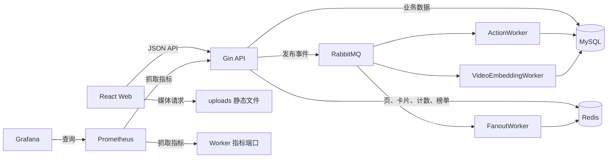

# GCFeed 全项目学习路线与验收清单

基于 2026-10-29 当前工作区源码整理。本文中的“深度学习”指深入掌握项目；当前推荐实现采用规则评分和本地 hash n-gram 向量。本文是静态代码分析与学习计划，没有启动服务、执行测试或取得性能测量结果。

## 1. 项目定位与完整地图

GCFeed 是短视频 Feed 工程，核心是内容发布、分发、消费、互动和反馈。运行架构是 Go API 单体加独立 Worker 进程。应重点学习请求编排、缓存、分页、异步副作用和一致性边界。



| 范围 | 源码入口（相对仓库根目录） | 学习重点 |
| --- | --- | --- |
| API 装配 | `apps/api/cmd/feed/main.go`、`internal/interfaces/http/router/router.go` | 依赖注入、可选组件、路由权限 |
| Worker 装配 | `apps/api/cmd/worker/main.go` | 三个消费者、生命周期、指标 |
| 账户 | `apps/api/internal/application/account/service.go` | 注册、登录、资料、JWT |
| 上传与视频 | `apps/api/internal/interfaces/http/upload/handler.go`、`application/video/service.go` | 文件与业务记录分离、幂等、事务、软删除 |
| Feed | `apps/api/internal/application/feed/service.go` | 四种策略、分页、缓存、批量组装 |
| 互动 | `apps/api/internal/application/interaction/service.go`、`worker.go` | 点赞/收藏同步与异步路径、评论、计数 |
| 关注关系 | `apps/api/internal/application/relation/service.go` | 关系事实、统计、历史内容回填 |
| 分发 | `apps/api/internal/application/video/fanout_worker.go` | 小作者 Inbox、大作者 Outbox、缓存预热 |
| 推荐 | `apps/api/internal/application/recommendation/service.go` | 候选池、兴趣、热度、新鲜度、作者打散 |
| 向量 | `apps/api/internal/domain/embedding/hash_ngram.go`、`application/embedding/` | 文本特征、归一化、向量持久化 |
| 曝光与观看 | `apps/api/internal/application/exposure/service.go` | 行为流水、曝光聚合、事件发布 |
| 消息 | `apps/api/internal/application/message/service.go` | 业务通知、幂等、已读、未读数 |
| 播放 | `apps/api/internal/application/playback/service.go` | 配置回退、预加载、QoS 流水 |
| Web | `apps/web/src/App.jsx`、`main.jsx`、`styles.css` | 页面状态、异步请求、视频生命周期 |
| 基础设施 | `apps/api/internal/infra/` | GORM、Redis、MQ、JWT、配置、指标 |
| 工程与部署 | `apps/docker-compose.yml`、`apps/deploy.yaml`、`apps/*/Dockerfile` | 依赖、端口、数据卷、进程入口 |
| 测试 | `apps/api/test/`、源码目录内的 `*_test.go` | API 行为、内存替身、Worker、缓存 |
| 设计与演进 | `docs/`、`openspec/`、`template/feed.html` | 业务意图、规格、原型与实现的差别 |

表中同一单元格内省略 `apps/api/internal/` 的路径沿用该前缀。

## 2. 先校准认识：实现与描述的差别

以下结论用于指导阅读，不代表已完成全面缺陷审计。

| 常见误解 | 当前代码证据与正确理解 |
| --- | --- |
| 这是训练深度学习模型的项目 | `HashNgramVectorizer` 默认生成 128 维文本特征；`rankScore` 是显式加权公式，未看到训练管线 |
| 用户画像由独立消费进程实时更新 | `LoadUserInterestVector` 在推荐查询时读取最近 30 天、最多 200 条正向事件关联的向量并加权；当前 Worker 入口只启动互动、分发、视频向量三个消费者 |
| 定义了观看事件消费者，就已运行起来 | MQ 定义了 `ConsumeViewEventRecorded`，但当前 `cmd/worker/main.go` 没有装配它 |
| 所有互动都异步写入 | 点赞/收藏支持异步路径；评论创建和删除直接调用仓储；异步点赞开始时仍查询 MySQL 统计 |
| 互动 Worker 批量落库 | `HandleActionChanged` 对每条事件调用一次 `repo.SetAction` |
| 发消息成功等于整个链路可靠完成 | 视频发布和观看事件发布错误被忽略；未看到生产者确认或事务消息表机制，需要分析业务写入与事件投递之间的缺口 |
| 领域层只依赖标准库 | 工程文档这样约定，但 `domain/account/entity.go` 直接使用 bcrypt；部分 Application 代码也直接使用 infra metrics |
| 所有列表都使用游标 | Feed、评论等使用游标；作者作品列表使用 limit/offset |
| TTL 每次随机抖动 5%～10% | `feedPageCacheTTL` 按缓存键哈希计算 10%～20% 正向偏移，同一键的偏移是确定的 |
| 架构文档的三张表就是整个数据库 | 当前迁移注册了 14 个模型，还包括关系、互动、曝光、消息、播放、向量等 |
| 监控完全未实现 | Compose 已包含 Prometheus/Grafana，代码已有指标；告警规则与通知闭环需另行确认 |
| Worker 负责把互动发进 MQ | API 侧服务发布事件，Worker 侧消费事件；入口中的部分行内注释不能代替函数实现 |

旧文档中的路径也需修正认知：鉴权文件是 `jwt_auth.go`，Fanout 文件是 `fanout_worker.go`，Feed 游标编解码位于 `application/feed/service.go`，没有独立的 `domain/feed/cursor.go`。

## 3. 学习方法与时间安排

建议已有 Go/HTTP/SQL 基础的读者分 3～4 周、约 40～60 小时完成；这是学习预算，不是项目质量保证。基础薄弱时把接口、事务、索引、React hooks 单独补齐，再推进对应阶段。

每次按一个行为阅读：

`用户操作 → Web 请求 → Router/鉴权 → Handler/DTO → Service → Domain/接口 → Repository/缓存/MQ → 返回与副作用`

每个模块完成一张笔记卡：

- 输入、输出、鉴权与业务不变量。
- 涉及的表、索引、Redis key、事件。
- 正常路径、重复请求、并发请求、失败路径。
- 现有测试证明了什么，哪些只是自己的推测。
- 一项设计取舍、一项可改进点，以及支持判断的函数位置。

勾选标准是“能解释并给出代码或实验依据”，不是“打开过文件”。

## 4. 阶段清单

### 阶段 0：基础与产品闭环（3～4 小时）

阅读：[README](../README.md)、[产品范围](product.md)、`apps/api/go.mod`、`apps/web/package.json`、Compose。

- [ ] 能读懂 Go 的接口、指针、错误包装、context、goroutine 和构造函数注入。
- [ ] 理解 SQL 事务、唯一索引、排序分页；能读 GORM 查询链。
- [ ] 理解 HTTP 方法、JWT、JSON、React state/ref/effect 的基本用途。
- [ ] 区分“游客浏览”和“登录用户操作”，列出四个 Feed 场景。
- [ ] 梳理注册 → 上传 → 发布 → 浏览 → 互动 → 关注 → 消息的产品流程。
- [ ] 启动学习环境后，用两个账号体验关注和消息，记录实际请求及响应。

产出：一页产品说明和服务拓扑图。验收：解释上传成功但发布失败时，系统中可能留下什么。

### 阶段 1：进程、分层与装配（3～4 小时）

阅读：两个 `cmd/*/main.go`、`infra/config`、`infra/database`、`interfaces/http/router/router.go`、`middleware/jwt_auth.go`。

- [ ] 画出配置 → 数据库 → 仓储 → Service → Handler → 路由的装配图。
- [ ] 区分运行时调用方向和源码 import 依赖方向。
- [ ] 找到 Functional Options 的实际调用，解释哪些能力可以不注入。
- [ ] 列出 API 与 Worker 启动条件的差别。
- [ ] 区分“未配置 Redis/MQ”“启动时连接失败”“运行期间故障”三种情况。
- [ ] 为公开、必需 JWT、可选 JWT、内部接口各找一个路由，并核对实际中间件。
- [ ] 说明 `/health` 返回正常与数据库、Redis、MQ 真正可用之间的区别。
- [ ] 找出进程退出、消费者取消和未完成任务处理的边界。

产出：依赖装配图、路由权限表。验收：新增一个可替换缓存实现，需要改哪些位置？

### 阶段 2：账户、上传与发布（4～6 小时）

阅读：account/video 四层代码、上传 Handler、`infra/jwt`、对应 API 测试。

- [ ] 从注册追到 `domainaccount.New`，定位 bcrypt 哈希与密码验证。
- [ ] 区分 `New` 与 `Restore*`，解释读取记录为何不重复走创建流程。
- [ ] 追踪登录签发 JWT、鉴权读取用户 ID、资料响应排除密码。
- [ ] 核对登出是否让已有 token 立即失效，给出实现依据。
- [ ] 追踪上传类型、大小、文件校验和媒体处理失败分支。
- [ ] 区分静态文件、视频元数据、统计表三种数据。
- [ ] 找到视频创建事务和幂等唯一约束；解释并发时“先查后插”的竞争。
- [ ] 追踪软删除与作者权限，以及删除后各缓存可能残留的内容。
- [ ] 追踪保存视频后发布事件的顺序，标记事件失败处理。

产出：发布时序图、账户与视频表关系图。验收：相同幂等键同时提交两次会发生什么？

### 阶段 3：Timeline 与缓存组装（5～7 小时，核心）

精读：`application/feed/service.go` 的 `GetFeed`、`TimelineStrategy.List`、`loadFeedPage`、`assembleFeedItems`、游标函数；再读 feed 仓储与缓存实现。

- [ ] 手写 `published_at DESC, id DESC` 的下一页条件，并用同时间戳视频举例。
- [ ] 解释多查一条如何计算 `has_more`。
- [ ] 区分页缓存、卡片缓存、统计缓存、用户个人互动状态。
- [ ] 追踪缓存全命中、部分命中、完全失效时的读写调用。
- [ ] 解释批量获取后为什么还要按 pageItems 恢复顺序。
- [ ] 记录首页 5 秒、后续页 45 秒的基础 TTL，以及 10%～20% 的确定性偏移。
- [ ] 区分卡片 15 分钟和统计 15 秒的缓存有效期。
- [ ] 解释 singleflight 的进程内作用范围，以及多个 API 副本为何仍可能分别回源。
- [ ] 标记缓存错误被忽略的位置，说明回源对 MySQL 压力的影响。
- [ ] 分析统计来自 Redis、个人点赞状态来自仓储时可能出现的短暂差异。

产出：一次 Feed 请求的数据读取图和缓存键表。验收：能估算一页 N 条视频的批量调用次数，而不是只说“用了缓存所以快”。

### 阶段 4：互动一致性与热门榜（5～7 小时，核心）

精读：interaction Service/Worker/Repository、`FeedCache.SetActionState`、统计分片函数、`HotStrategy`、MQ 发布与消费。

- [ ] 画出同步点赞和异步点赞两条流程，标出初始 MySQL 查询。
- [ ] 解释 `active` 目标状态、`delta`、幂等键之间的关系。
- [ ] 追踪 Redis WATCH 与事务写入，说明冲突时如何处理。
- [ ] 追踪计数基准值和 16 个分片增量的写入与合并。
- [ ] 分析 Redis 状态已改但 MQ 发布失败时的同步回退路径。
- [ ] 区分同一事件重复消费与“点赞、取消、旧点赞重投”的顺序问题。
- [ ] 追踪评论事实与统计的事务，并说明它与点赞路径的差别。
- [ ] 核对点赞 3、收藏 4、评论 5 的热度权重及取消行为。
- [ ] 解释最近 60 个分钟桶、窗口缓存、Hot 游标与数据库回退排序的关系。
- [ ] 区分成功 Ack、解析失败不重排队、业务失败重排队。
- [ ] 分析永久失败任务持续重排队的影响，不把“有重试”直接写成“可靠性已保证”。

产出：互动状态机和故障矩阵。验收：解释“请求返回成功”分别对 Redis、MQ、MySQL意味着什么。

### 阶段 5：关注关系与推拉结合（3～4 小时）

阅读：relation Service/Repository、`video/fanout_worker.go`、`FollowingStrategy`、Redis Inbox/Outbox。

- [ ] 画出关注关系事实与粉丝/关注统计的更新关系。
- [ ] 找到大作者粉丝阈值的定义，并说明边界条件。
- [ ] 解释普通作者如何按每批 500 个粉丝写入 Inbox。
- [ ] 解释大作者写 Outbox，读取时如何与 Inbox 合并。
- [ ] 追踪关注新作者时的历史回填；说明为何大作者跳过回填。
- [ ] 分析取消关注、作者跨越阈值、索引过期、部分分发失败的处理。
- [ ] 解释 Fanout 前的卡片/统计预热及其失败影响。
- [ ] 区分 Redis 作者 Outbox 与“保证数据库和消息一致的事务 Outbox”，两者用途不同。

产出：推拉选择表、关注流读写时序图。验收：为什么给所有作者采用相同分发方式会有成本问题？

### 阶段 6：推荐、向量与反馈闭环（5～7 小时）

阅读：recommendation、embedding、exposure 的应用和持久化代码，以及三个模块的测试。

- [ ] 跟踪 `Recommend → ListCandidatePool → rankCandidates → filterByCursor → interleaveByAuthor`。
- [ ] 解释候选池按请求大小放大、最少 50、最多 500 的限制及覆盖范围。
- [ ] 手算一段短文本的特征生成步骤：归一化、token/字符 n-gram、哈希、L2 归一化。
- [ ] 区分文本 hash 特征与经过训练的语义向量。
- [ ] 追踪视频发布事件到 `video_embedding` 的写入和模型标识。
- [ ] 追踪用户兴趣向量的查询、行为权重、平均聚合和余弦相似度。
- [ ] 解释有画像时相似度/热度/新鲜度的 0.70/0.20/0.10 权重，以及无画像时 0.65/0.35 的回退。
- [ ] 区分候选排除曝光、曝光决策接口、实际曝光记录写入三件事。
- [ ] 解释观看流水同步保存与随后发布 MQ 事件的先后关系。
- [ ] 核对当前没有接入观看事件消费者，不把接口定义当成已运行功能。
- [ ] 检查 Web 的实际事件类型；区分 QoS 报告与推荐使用的正向观看事件，确认反馈是否连通。
- [ ] 分析分数随时间变化、候选池截断、页内作者打散对分页的影响。

产出：推荐数据依赖图、两组手算排序样例、反馈闭环缺口清单。验收：新用户、无向量视频、已曝光视频分别如何处理？

### 阶段 7：前端、消息与播放（4～6 小时）

阅读：`apps/web/src/App.jsx` 中 App、FeedPage、VideoStage、MessagesPage、ProfilePage、UploadPage、apiRequest；配合 message/playback 后端。

- [ ] 画出路由、session、localStorage 与服务端登录态之间的关系。
- [ ] 列出 Feed 的 loading、ready、error、auth 等状态及转移条件。
- [ ] 追踪首屏与加载更多的 cursor、request ID、去重和重复请求保护。
- [ ] 分析切换场景时旧请求晚返回是否会污染当前列表。
- [ ] 解释 `useState` 与 `useRef` 的不同用途，以及 effect 的清理函数。
- [ ] 追踪曝光去重与上报失败处理，确认是否存在重试。
- [ ] 追踪预加载配置回退、资源预热和 VideoStage 播放/暂停生命周期。
- [ ] 区分首帧时间、卡顿次数、观看时长、曝光事件的含义和存储位置。
- [ ] 跟踪一次点赞/关注通知到消息列表、未读计数和已读更新。
- [ ] 检查服务端写操作失败后，页面状态如何恢复。
- [ ] 解释 Nginx `/api/`、`/uploads/` 代理和 SPA 回退的作用。

产出：前端状态图，以及“刷到视频 → 播放 → 上报 → 后端保存”的时序图。

### 阶段 8：数据、测试、部署与可观测性（4～6 小时）

阅读：所有 persistence 模型、migration、测试、Dockerfile、Compose、deploy.yaml、metrics、Prometheus/Grafana 配置。

- [ ] 依据迁移注册的 14 个模型补齐 ER 图；区分逻辑关联和实际数据库约束。
- [ ] 为视频、互动、关注、消息、观看事件分别写出唯一键与事务边界。
- [ ] 找到 Timeline 索引，结合查询条件解释列顺序；实际学习实验中用 EXPLAIN 验证。
- [ ] 标注哪些 API 测试使用内存仓储，哪些代码路径需要真实外部依赖才能验证。
- [ ] 阅读已有成功、校验、鉴权、重复请求、缓存与 Worker 用例，不把内存测试等同于生产数据库集成验证。
- [ ] 区分 Web 构建通过与用户交互正确；当前 package.json 未定义前端测试脚本。
- [ ] 解释宿主机端口和容器端口、配置挂载、上传目录及数据库数据卷。
- [ ] 对比 Compose 和 Kubernetes 清单的配置与进程覆盖情况。
- [ ] 追踪 API/Feed/Worker 指标从代码埋点到 Prometheus 再到 Grafana。
- [ ] 区分 Worker 任务成功率与队列积压；现有 Prometheus 抓取配置只列出 API 和 Worker。
- [ ] 为冷缓存、热缓存、真实登录用户和不同场景分别设计测量条件。
- [ ] 记录吞吐、P95、错误率、返回条数与数据量，不用空 Feed 的 QPS 证明业务性能。

产出：ER 图、测试覆盖矩阵、部署说明、带环境与数据规模的实验记录。

### 阶段 9：独立修改与复述（4～6 小时）

任选一个明确的小任务，后续实施时再补相应验证：

- [ ] 修复首屏/分页请求切换场景时的竞态，明确旧响应丢弃规则。
- [ ] 补齐真实观看事件上报，验证其是否进入推荐画像数据来源。
- [ ] 为消息投递失败设计可重试记录，先说明事务边界再实现。
- [ ] 给内容删除设计缓存失效方案，覆盖页、卡片、关注索引和推荐读取。
- [ ] 若选择审核能力，检查详情、作者作品、四类 Feed、预加载、缓存等所有公开入口。
- [ ] 按 OpenSpec 和工程规范描述需求、修改范围、失败行为与验收条件。

最终验收：不用文档讲解十分钟，能从用户操作讲到 SQL/Redis/MQ，并明确哪些结论有测试或测量依据。

## 5. 后续学习时可执行的命令

以下是学习者后续执行的步骤；本次分析未运行。PowerShell 从仓库根目录开始。

```powershell
# 启动 Compose 学习环境
Push-Location apps
docker compose up -d --build
docker compose ps
Pop-Location

# 后端测试
Push-Location apps/api
go test ./...
Pop-Location

# 已安装前端依赖时执行构建
npm --prefix apps/web run build
```

Go 版本约束以 `apps/api/go.mod` 为准。前端首次安装依赖可使用 `npm --prefix apps/web ci`。依赖安装和启动需要相应工具与网络环境。

[性能测试文档](performance-testing.md) 内嵌了 k6 脚本，但主要示例是 Bash 写法。在 PowerShell 学习时，把所需 JavaScript 脚本提取为文件，再使用 k6 的 `-e` 参数传入场景、并发与时长，避免直接粘贴 Bash heredoc 或变量赋值。

## 6. 深入理解所需的故障推演

先纸上推演，再在隔离的学习环境复现。

| 情况 | 要追踪的代码和数据 | 必须回答的问题 |
| --- | --- | --- |
| Redis 不可用 | Feed 回源、互动 `SetActionState` | 哪些读路径降级，哪些写路径直接失败？ |
| Redis 成功、MQ 发布失败 | `setActionAsync`、同步回退 | 状态、统计、热度是否一致？ |
| 视频提交后进程退出 | `CreatePublished`、发布事件 | 视频存在，但向量和分发是否完成？如何发现和补偿？ |
| Worker 写入后 Ack 丢失 | MQ 消费循环、仓储事务 | 重复消费如何处理？乱序与重复有何不同？ |
| 取消关注但 Inbox 有旧内容 | Following 索引读取与过滤 | 是否仍会显示该作者？ |
| 删除视频但卡片缓存未过期 | Delete、卡片与页缓存 | 各入口什么时候停止展示？ |
| 推荐第二页时分数变化 | 推荐排序和游标 | 是否出现漏项或重复？能否接受？ |
| 页面切场景时旧请求完成 | FeedPage 的加载更多逻辑 | 旧数据是否混入新列表？ |
| MQ 观看事件无人消费 | Worker 装配、MQ 队列 | 积压能否被现有指标发现？ |

不要把上述问题直接写成“已确认的缺陷”；给出具体条件、源码证据和复现结果后再定性。

## 7. 最终通关标准

- [ ] 有一张实际部署图、一张 ER 图、一个路由权限表。
- [ ] 有发布、Feed 读取、点赞、关注分发、推荐反馈五张时序图。
- [ ] 有 Redis key/TTL/写入者/读取者/失效方式清单。
- [ ] 有 MQ 事件/交换机/队列/消费者/失败处理清单。
- [ ] 能解释每个模块的输入输出、事实数据和副作用。
- [ ] 能从测试说明中指出替身与真实依赖的差别。
- [ ] 完成至少一个跨层小改动，并能说明验证证据。
- [ ] 能指出当前实现的三项优势与三项限制，不使用未经测量的性能数字。

建议笔记评分：0 = 没读；1 = 能定位；2 = 能解释；3 = 能用例子验证；4 = 能独立修改。核心阶段 3～6 达到 3，其余达到 2，再通过实际改动争取达到 4。
